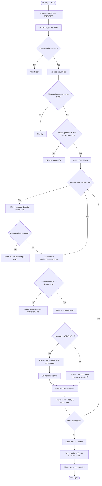

# NAS Downloader — Architecture, Flow, and Troubleshooting Guide

This document describes the software architecture, module responsibilities, runtime lifecycle, and common troubleshooting steps for **NAS Downloader** (package `nas_spec_sync`). Any AI agent or developer maintaining, debugging, or extending this codebase should consult this reference.

---

## 1. System Architecture & File Structure

```text
Nas_download spec/
├── cli.py                     # CLI entrypoint (argument parsing, signal handling, logging setup)
├── config.example.json        # Generic template configuration file (JSON/YAML supported)
├── test_connection.py         # Diagnostic script to verify NAS SFTP/FTPS auth & remote_dir
├── explore_nas.py             # Diagnostic script to discover exact folder paths on NAS
├── example_integration.py     # Consumer module reference implementation
├── INTEGRATION_GUIDE.md       # Public API and data contracts for downstream consumers
├── ARCHITECTURE.md            # (This file) Architecture, code breakdown & debugging guide
├── LINUX_DEPLOYMENT.md        # Ubuntu 14.04 & Ubuntu 18.04 setup, tests, and service guide
├── README.md                  # Quickstart and project overview
├── requirements.txt           # Python dependencies (paramiko, PyYAML, py7zr, rarfile)
│
├── nas_spec_sync/             # Core Python package
│   ├── __init__.py            # Package exports
│   ├── clients.py             # Abstract NasClient, SftpClient (paramiko), FtpsClient (ftplib)
│   ├── config.py              # Strongly-typed dataclasses and validation (AppConfig)
│   ├── extractor.py           # Archive extraction (zip/7z/rar/tar) & intact document placement
│   ├── logger_setup.py        # Console + RotatingFileHandler logging setup
│   ├── matcher.py             # Simple wildcard (*, ?) & substring folder/file matching
│   ├── notifier.py            # ProcessedItem, SyncResult, manifest writer & webhook sender
│   ├── state.py               # Persistent JSON state store (remote_path, size, mtime)
│   └── sync.py                # Core orchestration engine (NasSpecSync)
│
├── tests/
│   └── test_sync.py           # Unit tests with in-memory MockNasClient
└── logs/                      # (Generated at runtime) Rotating log files (e.g. nas_sync.log)
```

---

## 2. Core Modules & Responsibilities

| Module | Purpose | Key Classes / Functions |
| :--- | :--- | :--- |
| `config.py` | Parses JSON/YAML into dataclasses; validates required fields, ports, and timeouts. | `AppConfig`, `NasConfig`, `LocalConfig`, `load_config()` |
| `clients.py` | Unified file operations abstraction over SFTP & FTPS protocols. | `NasClient`, `SftpClient`, `FtpsClient`, `create_nas_client()` |
| `matcher.py` | Simple wildcard matching (`*`, `?`) and substring searching (brackets like `[100]` are literal). | `match_pattern()`, `match_any()` |
| `state.py` | Atomic persistence of processed files by remote path, size, and modification time. | `StateStore`, `FileRecord` |
| `extractor.py` | Extracts archives into a unique staging folder with ZipSlip check, or copies documents intact; cleans up temp files. | `extract_and_cleanup()`, `is_archive()` |
| `notifier.py` | Result structures, callbacks, atomic manifest writing, and webhook notification. | `SyncResult`, `ProcessedItem`, `write_manifest()`, `send_webhook()` |
| `logger_setup.py` | Formatted console output + rotating file handler with file/line number details. | `configure_logging()` |
| `sync.py` | Main orchestrator managing discovery, concurrency stability checks, downloads, extraction, and lifecycle loops. | `NasSpecSync.run_once()`, `run_forever()` |
| `cli.py` | Command-line interface with `--config`, `--once`, `--verbose`, and `--log-file`. | `main()` |
| `test_connection.py` | Standalone connectivity & authentication tester for SFTP/FTPS. | `test_connection()` |
| `explore_nas.py` | Interactive directory explorer to locate exact `remote_dir` paths on NAS. | `explore_nas()` |

---

## 3. Runtime Execution Flow



---

## 4. Key Mechanisms & Safeguards

### 4.1 Concurrency & In-Progress Uploads (500–600MB files)
If a user or process is uploading large files to the NAS while this application scans:
1. **Extension Filter**: Any file ending with `.part`, `.tmp`, `.filepart`, or `.downloading` is immediately ignored.
2. **Two-Point Stability Probe**: Before downloading, the engine records initial `(size, mtime)` and pauses for `concurrency.stability_wait_seconds` (default: 5.0s). It then queries the NAS again:
   - If size or mtime differs, or size is 0, the file is logged as unstable and deferred to the next cycle.
3. **Download Size Assertion**: During download, bytes written to local temporary file are asserted against expected remote size. Any mid-transfer mutation causes an error and cleans up the partial download.

### 4.2 Overwrite Handling
- The state engine stores `(remote_path, size, mtime)`.
- If a file on NAS is overwritten under the same path with updated contents or mtime:
  - `is_processed_and_unchanged()` returns `False`.
  - The file is re-downloaded and atomically replaces the previous local directory/file.
  - Emitted item has `is_overwrite = True`.

### 4.3 Multi-Format Archive Extraction & Direct Document Handling
- **Archive Extraction (`.zip`, `.7z`, `.rar`, `.tar`, `.tgz`)**:
  - `.zip`: Extracted via native Python `zipfile` with ZipSlip protection.
  - `.7z`: Extracted via `py7zr` (with fallback to system `7z`/`7za` CLI).
  - `.rar`: Extracted via CLI (`unrar`, `unrar-free`, `7z`, `tar`) or Python `rarfile`.
  - Extracted into a staging folder and atomically swapped (`os.replace`) into `<download_dir>/<folder_name>/<stem>/`.
  - Temporary local archive file is deleted if `keep_archive_after_extract: false`.
- **Direct Documents / Non-Archives (Excel `.xlsx`/`.xls`, PDF `.pdf`, CSV, TXT, Word, etc.)**:
  - Detected automatically via `is_archive()`.
  - **No extraction is attempted**. The file is atomically copied into `<download_dir>/<folder_name>/<filename>`.
  - `item.extracted_dir` points directly to the saved file path on local disk.

---

## 5. Logging & Diagnostic Tools

### Log Configuration
Logs are output to both **Console (stdout/stderr)** and a **Rotating File** (default: `./logs/nas_sync.log`, 10MB per file, 5 backups).

To run with verbose debug logs:
```bash
python cli.py --config config.json --verbose
# Or specify an explicit log file location:
python cli.py --config config.json --log-file ./logs/debug_run.log -v
```

### Diagnostic Commands
- **Test connection & authentication**:
  ```bash
  python test_connection.py -c config.json
  ```
- **Explore NAS directory structure**:
  ```bash
  python explore_nas.py -c config.json
  python explore_nas.py -c config.json -p /data
  ```

---

## 6. Troubleshooting Guide for Future Agents/Engineers

### Issue 1: SFTP Connection Failure or Timeout
- **Symptoms**: `socket.timeout`, `paramiko.ssh_exception.SSHException`, or connection refused.
- **Check**:
  1. Run `python test_connection.py -c config.json` to get full Paramiko transport debug output.
  2. Inspect `config.json` -> `nas.host`, `nas.port` (default: 22), `nas.username`, `nas.password` / `private_key_path`.
  3. Ensure NAS SSH service allows SFTP subsystem.

### Issue 2: `No such file` on `remote_dir`
- **Symptoms**: `[Errno 2] No such file` during `list_dir`.
- **Check**: Many NAS SFTP servers chroot users to the shared folder root (e.g. `/Main/...` instead of `/volume2/Main/...`). Run `python explore_nas.py -c config.json` to discover exact visible paths.

### Issue 3: FTPS Authentication or Certificate Errors
- **Symptoms**: `ftplib.error_perm: 530 Login incorrect` or SSL errors.
- **Check**:
  1. Implicit FTPS (port 990): set `"implicit_tls": true` and `"port": 990`.
  2. Explicit FTPS (port 21): set `"implicit_tls": false` and `"port": 21`.

### Issue 4: Files Not Detected (Pattern Mismatch)
- **Symptoms**: `Cycle complete. Processed=0` despite files existing on NAS.
- **Check**:
  1. Check `patterns.folder_patterns` and `patterns.file_patterns`.
  2. Check `patterns.case_sensitive` (keep `false` unless exact casing is needed).
  3. Check `concurrency.ignore_extensions` for `.tmp` or `.part` suffixes.

### Issue 5: Large File Constantly Skipped
- **Symptoms**: `result.skipped_unstable` continuously contains the file path.
- **Check**: Upload may still be active, or NAS timestamp jitter requires tuning `concurrency.stability_wait_seconds` (e.g., `10`).

### Issue 6: Corrupt Archive
- **Symptoms**: `zipfile.BadZipFile` or extraction error in `result.errors`.
- **Handling**: The engine cleans up temp files and **does not** write to `state.json`, so it automatically retries on the next cycle.
